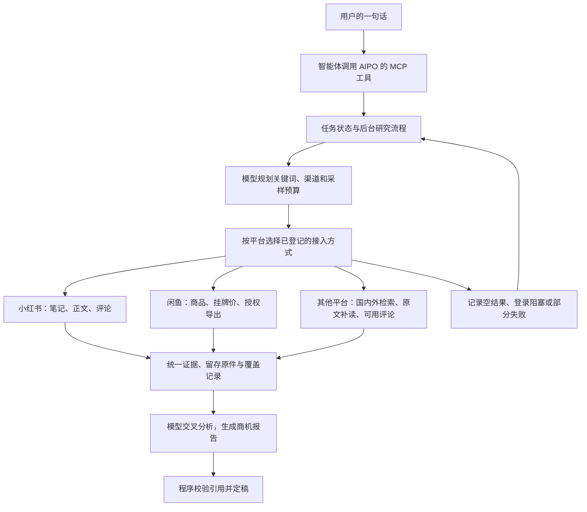

# 架构与工具契约

## 产品边界

研究意图有三类：找新项目、评估已有想法、研究指定平台。交付是一份可以直接阅读的中文商机报告，包含证据、反例、成本假设和最小付费验证。旧商机技能成为聊天入口；研究规划、执行和报告都在服务内完成。知几 X 的预测、定局和信誉功能是相邻产品，背景保存在旧项目档案。

## 结构

对外只有一个 AIPO 服务。小红书 MCP、闲鱼命令行工具或 MCP、海外和中文检索脚本均可独立运行。AIPO 根据任务选择合适路径，将结果转换为统一证据。按平台和能力分派，如搜索、正文、评论、商品、导入；同一条笔记从两个项目取得时，保留观察出处并避免把同一条材料算作两份独立证据。

首版建议常驻进程运行在本机。SQLite（单文件数据库）存任务、来源进度和重试记录，原始材料和报告沿用独立归档目录。平台登录由来源自身管理。模型负责理解问题、选择样本、生成判断；程序控制任务、预算、限时、存储和引用校验。模型输出校验只证明结构和引用符合要求，报告质量需要用验收样本独立检查。

## 对外工具

| 工具 | 输入 | 返回与行为 |
| --- | --- | --- |
| `start_research`（发起研究） | `question`（必填的一句话），可选 `request_id`（调用方重试编号）、`platforms`（平台范围） | 返回任务编号和初始状态。同一重试编号及相同参数复用任务；参数冲突返回可解释错误。后台执行研究。 |
| `get_research`（查看研究） | `research_id`（任务编号） | 返回研究状态、当前阶段、各来源真实进度和阻塞原因。定稿时返回中文报告、证据索引和覆盖情况。 |
| `resume_research`（继续研究） | `research_id`，可选 `answer`（必要的补充信息） | 登录或依赖恢复后续跑未完成步骤；复用已写入的证据。重复恢复请求保持同一任务。 |

任务状态至少有等待、执行中、等待用户、已完成、失败。每个来源单独保存空结果、成功、部分成功、待登录、缺配置、超时或不可用等实际结果。报告可在样本不足时完成，返回已知证据与缺口。指定平台不可用时，公开网页取得的材料明确标为公开线索。用户未指定平台时，按研究问题选不同证据类型，避免把所有来源跑成固定串行步骤。

## 证据与报告

- 每条证据记录稳定编号、平台、采集路径、原始来源、发布时间或未知、观察时间、实际读取深度、材料类型以及可重读的原件引用。原件可保留校验值。报告对外展示可安全引用的来源链接。
- 讨论和评论记录需求表达、替代办法与反例。商品记录供给、挂牌价和描述。标明卖家自述、平台公开标记、独立核验成交和估算利润的区别。
- 报告包含研究问题、实际使用的来源与覆盖范围、机会和目标客户、支持与削弱证据、价格与交付成本假设、最小付费验证和停止条件。重要判断引用证据编号或标为假设。
- 中断和重试沿用原任务编号。失败的来源能独立继续，其他来源的原件和报告状态可回读。运行环境提供的平台登录与模型配置通过专用配置交给各自服务。
